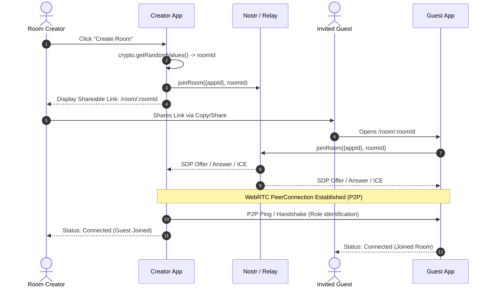
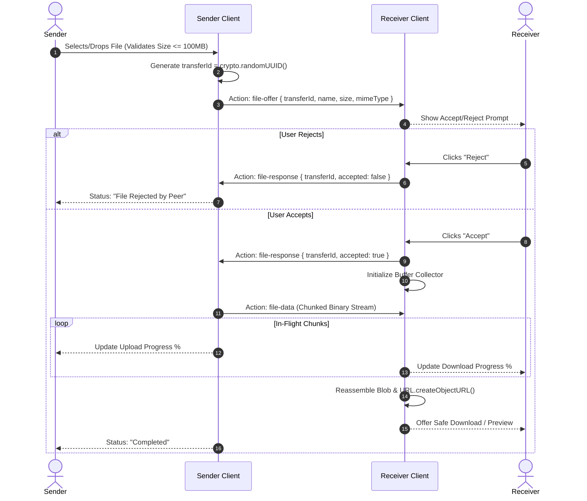
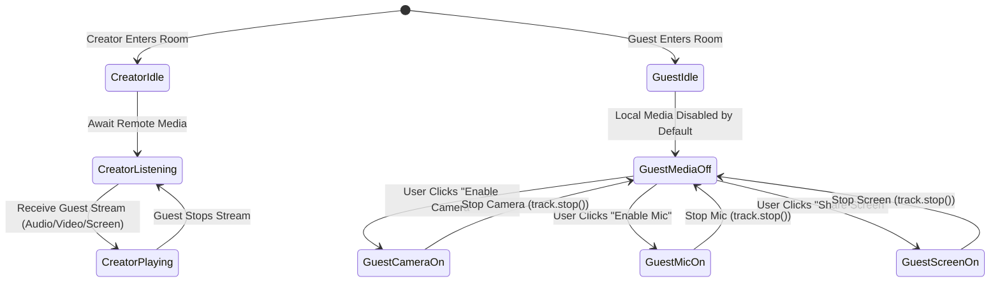

# Architecture Specification: Private Connect

## 1. System Overview
Private Connect is an entirely client-driven, zero-backend, peer-to-peer web application designed for private, temporary file sharing, real-time messaging, optional guest-controlled audio/video, screen sharing, and multiplayer games.

```mermaid
flowchart LR
    subgraph Browser A [Creator Browser]
        UI_A[UI Layer]
        State_A[Zustand Stores]
        P2P_A[P2P Engine / Trystero]
        File_A[File Pipeline]
        Media_A[Media Receiver]
    end

    subgraph Browser B [Guest Browser]
        UI_B[UI Layer]
        State_B[Zustand Stores]
        P2P_B[P2P Engine / Trystero]
        File_B[File Pipeline]
        Media_B[Media Capture & Producer]
    end

    subgraph Signaling [Federated Signaling Relays]
        Relays[(Nostr / WebTorrent Relays)]
    end

    P2P_A -. Handshake SDP/ICE .-> Relays
    P2P_B -. Handshake SDP/ICE .-> Relays
    P2P_A ===|WebRTC Data Channel (Chat & Files)|=== P2P_B
    Media_B ===|WebRTC MediaStream (Guest AV & Screen)|===> Media_A
```

---

## 2. Layered Architecture & Module Boundaries

The codebase is organized into strict decoupled layers:

```
src/
├── app/                  # Application Root & Routing
│   ├── router/           # React Router Route Definitions
│   └── App.tsx           # Providers and root shell
├── config/               # Immutable App Constants (Limits, Relays, Timeouts)
├── features/             # Domain Feature Modules
│   ├── rooms/            # Room creation, invitation, link generation, bearer validation
│   ├── file-sharing/     # Two-way chunked binary transfer, offer/accept protocol
│   ├── chat/             # Ephemeral in-memory text messaging & system alerts
│   ├── media/            # Audio/video receivers & guest producer controls
│   ├── screen-sharing/   # DisplayMedia stream management & remote projection
│   └── games/            # Turn-based P2P games (Tic Tac Toe, Rock Paper Scissors)
├── services/             # Core I/O & Networking Services
│   ├── p2p/              # Trystero adapter, connection management, action builders
│   └── webrtc/           # MediaStream and ICE diagnostics helpers
├── store/                # Zustand State Slices (Focused, Ephemeral, Unpersisted)
├── components/           # Reusable UI & Layout Components
│   ├── ui/               # Buttons, Modals, Badges, Tooltips, Progress Bars
│   ├── layout/           # App Header, Room Shell, Responsive Split View
│   └── feedback/         # Toast alerts, Connection banners, Error screens
├── types/                # Global TypeScript definitions
└── utils/                # Sanitization, Formatting, Crypto, Blob management
```

---

## 3. Room & Connection Lifecycle



### Connection States:
1. `idle`: No active room connection.
2. `generating`: Cryptographically generating random room identifier.
3. `waiting`: Creator connected to signaling, awaiting peer arrival.
4. `connecting`: Guest joined signaling topic; WebRTC ICE gathering in progress.
5. `connected`: Direct peer-to-peer data channel active.
6. `disconnected`: Peer connection closed or ICE heartbeat timeout.
7. `error`: Signaling unreachable or browser incompatibility.

---

## 4. Two-Way File Transfer Lifecycle

To guarantee security and eliminate unexpected bandwidth/memory consumption, file transfers require explicit offer/acceptance.



---

## 5. Media & Screen Share Lifecycle (Strict Roles)



- **Creator Rule Enforcement:** The Creator role UI has no bindings to media capture devices. Any call to `getUserMedia` on Creator is strictly prevented at the code level.
- **Guest Rule Enforcement:** Media streams are requested only upon explicit user button click. Default state is off.

---

## 6. Multiplayer Game State Synchronization

Games use an explicit peer-to-peer message protocol (`game-action`):
- Both participants start in `lobby` state.
- Either participant can propose starting a game (e.g., Tic Tac Toe).
- Opponent accepts or declines.
- Turns alternate based on deterministic role assignment (Creator = Player 1 / X, Guest = Player 2 / O).
- Every move sent over the data channel is checked against local game validation logic before board mutation.
- When game concludes (win/draw), both players can click "Play Again" to reset state.

---

## 7. Error Handling & Recovery Strategies

| Failure Mode | Impact | Recovery Action |
|---|---|---|
| Invalid Room ID in URL | Guest joins malformed topic | Validate format regex `^[a-zA-Z0-9_-]{16,36}$`; redirect to `/invalid-room` |
| Signaling Relays Down | Unable to exchange SDP | Surface clear alert: "Signaling service unavailable. Please retry in a few moments." |
| ICE Connection Failed | WebRTC cannot traverse NAT/Firewall | Alert: "Direct P2P connection could not be established between these two networks (Symmetric NAT/Firewall blocked)." |
| File Exceeds Limit | Memory bloat | Block upload client-side immediately before sending offer (`file.size > 100MB`). |
| Peer Abruptly Closes Tab | Transfer / Game frozen | Detect `onPeerLeave`; set status to `disconnected`, cleanup active transfers and media streams. |
| Camera Permission Denied | Guest cannot share video | Catch `NotAllowedError`; display actionable message: "Camera access was denied in browser settings." |
